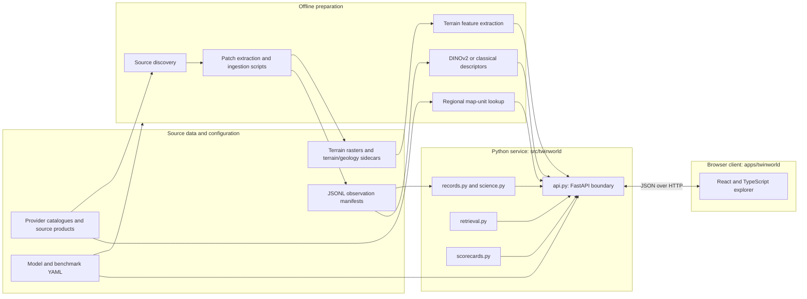

# ENOM / TwinWorld architecture

ENOM is a research prototype for finding and inspecting planetary surface
analogues. TwinWorld serves two related but separate workflows: image retrieval
over a small Earth/Mars pilot, and terrain scorecards that compare Moon or Mars
observations with Earth DEM contexts. A rank is a lead for investigation; it is
not evidence of geological equivalence or mission suitability.

## System view

## Responsibilities

| Area | Responsibility |
| --- | --- |
| `data/manifests/` | Source-backed observation records, catalogue locations, and small review inputs. These describe observations and provenance; they do not imply that corresponding rasters are present. |
| `data/patches/`, `data/terrain/` | Generated or downloaded rasters and checked-in JSON provenance sidecars. Large raster assets are generally excluded from Git. |
| `data/geology/` | Source-backed categorical map-unit lookups for indexed Mars locations; regional context rather than terrain measurements. |
| `configs/` | Pilot-site selection, model identities, benchmark settings, and review-set configuration. |
| `scripts/` | Explicit preparation and evaluation commands: discovery, ingestion, pilot construction, benchmark/report generation, and scorecard reproduction. |
| `src/twinworld/records.py` | Image-patch manifest parsing and field validation (`PatchRecord`). |
| `src/twinworld/geospatial.py` | Mars longitude conversion, polygon containment, and sphere-based Mars distance helpers. |
| `src/twinworld/science.py` | Shared measurement, uncertainty, availability, provenance, and evidence types used by terrain processing and API responses. |
| `src/twinworld/patching.py` | Fixed-ground-size raster extraction in an already projected CRS. |
| `src/twinworld/pds.py` | Bounded PDS byte-range requests with status, range-header, and payload-length checks shared by product adapters. |
| `src/twinworld/features.py`, `vision.py` | Classical image descriptors, device selection, and DINOv2 embeddings with cache identity metadata. |
| `src/twinworld/terrain.py` | DEM-derived terrain measurements on projected metric grids. |
| `src/twinworld/retrieval.py` | Cross-body nearest-neighbour ordering by cosine similarity. |
| `src/twinworld/scorecards.py` | Missing-data-aware terrain comparison and separate provisional mission screening. |
| `scripts/ingest_mars_geology.py` | Looks up indexed Mars coordinates in USGS SIM 1083 polygons and writes mapped, unmapped, or boundary-ambiguous records. |
| `src/twinworld/api.py` | Loads configured artifacts, assembles observation/evidence payloads, applies retrieval and scorecard operations, and exposes the HTTP API. |
| `apps/twinworld/src/main.tsx` | Loads API data and owns explorer state and requests. |
| `apps/twinworld/src/ScorecardView.tsx` | Renders the terrain scorecard from typed API results and callbacks; it does not calculate rankings. |
| `apps/twinworld/src/types.ts`, `format.ts` | Shared API response types and coordinate display formatting. |
| `apps/twinworld/src/style.css` | Shared layout, component, and responsive styles. |
| `tests/` | Unit and API regression coverage for coordinates, raster processing, retrieval, scorecards, provenance, and missing-data behavior. |

## Data flow

### Image retrieval (Earth/Mars pilot)

1. `configs/pilot-sites.json` and provider catalogues feed `scripts/build_pilot.py`.
2. The builder selects source observations, extracts fixed-ground-size projected patches through `twinworld.patching.extract_metric_patch`, and writes `PatchRecord` rows to `data/manifests/pilot-100.jsonl`.
3. `twinworld.vision.embed_dinov2` reads those patches, applies the declared grayscale/resize preprocessing, and writes an embedding matrix plus metadata. The metadata ties row order and values to image IDs, source checksums, model revision, and preprocessing identity.
4. `twinworld.api._load` pairs manifest records with the embedding artifact. It checks ordered image IDs, configured model ID/revision/dimension, preprocessing ID, matrix shape, and finite values before serving rankings.
5. `twinworld.retrieval.search` normalizes vectors and sorts opposite-body candidates by dot product (cosine similarity for unit vectors). The API adds terrain coverage, provenance, comparison evidence, and explicit limitations where available.
6. The React client displays the returned values and requests pair details through the API. It is a view of server-produced evidence, not a second scoring implementation.

Terrain context ingestion is an adjacent path: `scripts/ingest_copdem.py` and
`scripts/ingest_mola.py` produce context rasters and provenance sidecars for
pilot observations; `twinworld.terrain.terrain_features` derives measurements
from projected DEMs. MOLA support counts distinguish observed bins from
interpolated topography, and unsupported measurements remain unavailable.

### Planetary-to-Earth terrain scorecard

The scorecard is separate from image retrieval: the lunar site is not inserted
into the DINOv2 image index. A bounded LOLA crop or MOLA context is paired with
Earth terrain contexts; `twinworld.scorecards.compare_candidate` checks units
and feature scales, computes variable scores, and renormalizes over the
positive-weight variables that are actually comparable. The API returns each
component, data completeness, provenance, and limitations. The browser renders
those results and a separate provisional mission screen. The screen is not
folded into the terrain similarity score.

For indexed Mars reference sites, the API can attach a USGS SIM 1083 regional
map-unit classification from `data/geology/`. It is returned as
`geology_evidence` for context only; it is not a terrain variable and does not
change candidate ranks or provisional mission screening.

## Where changes belong

- Add a sourced pilot observation through the relevant configuration and
  preparation script, then regenerate and validate the manifest and artifacts.
- Add a new input product with an ingestion adapter that records product ID,
  source URL, units, coordinate reference, resolution, missing-data meaning,
  and processing steps in a sidecar. Keep provider-specific decoding in that
  adapter.
- Add a terrain variable in `terrain.py` (or a product-specific adapter where
  its support semantics differ), define its units and physical scale, and cover
  valid, missing, and scale-mismatch cases in tests. Register scorecard
  tolerance/weights in `scorecards.py` only when the comparison is scientifically
  interpretable.
- Add response fields and endpoint behavior in `api.py`; update TypeScript
  response types and presentation in `apps/twinworld/` to match the API.
- Add a new retrieval method in the retrieval layer and keep its meaning
  distinct from terrain evidence and mission screening.

## Scientific boundaries

- Earth, Mars, and Moon coordinate conventions differ; keep conversions close
  to data ingress and preserve the original CRS/projection in provenance.
- Physical derivatives require projected grids with known linear units. A
  geographic-degree grid must not be treated as a metric grid.
- Missing or unobserved values are not zero and are not evidence of dissimilarity.
- Cosine similarity is a feature-space ranking value. Terrain scores are
  tolerance-based ranking indices. Neither is a probability or validation
  statistic.
- The pilot has no independent analogue relevance labels. Do not describe
  rankings as retrieval accuracy or validated analogue performance.

